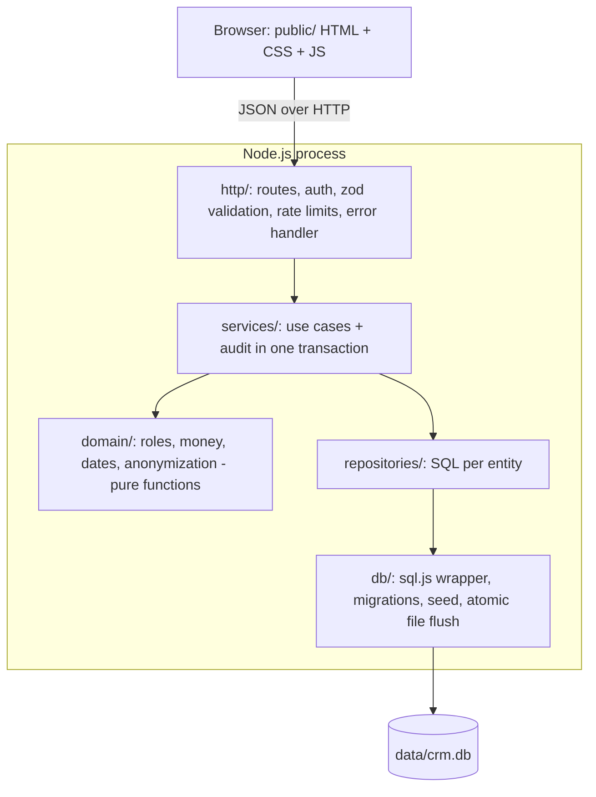

# Enterprise CRM

[](https://github.com/codebyjuliamendes/enterprise-crm/actions/workflows/ci-cd.yml)


A small, self-hosted CRM for sales teams: contacts, a deal pipeline (kanban), role-based access,
an audit trail of every change and an LGPD anonymization endpoint. It runs as a single Node.js
process with an embedded SQLite database, so it starts with one command and needs no external
services.

## Features

- **Contacts**: create and list contacts with e-mail, phone and tags.
- **Deal pipeline**: kanban with the stages Lead → Qualified → Proposal → Won / Lost; create deals
  (optionally logging a meeting note) and move them between stages.
- **Dashboard KPIs**: contacts, open deals, open pipeline value and won revenue.
- **Roles**: `admin`, `manager`, `sales`, `viewer` (see the table below). Sales reps only see and
  change the records they own.
- **Audit log**: every create / stage change / anonymization is written in the same database
  transaction as the change itself, including the old and new values.
- **LGPD erasure**: `POST /api/lgpd/anonymize` irreversibly removes a contact's personal data (or
  every contact's) and clears related activity notes.
- **API docs**: OpenAPI 3 spec at `/swagger.json`, Swagger UI at `/api-docs`.
- **UI**: plain HTML/CSS/JS (no build step), light and dark themes, works on phones (390 px).

| Action                          | admin | manager |  sales   | viewer |
| ------------------------------- | :---: | :-----: | :------: | :----: |
| View dashboard, contacts, deals |   ✓   |    ✓    | own only |   ✓    |
| Create contacts and deals       |   ✓   |    ✓    |    ✓     |        |
| Move deals between stages       |   ✓   |    ✓    | own only |        |
| Read audit log                  |   ✓   |         |          |        |
| Run LGPD anonymization          |   ✓   |         |          |        |

## Quick start

Requirements: Node.js 22+.

```bash
npm install
npm run dev            # http://localhost:3004, restarts on file changes
```

In development the database is created at `data/crm.db` and seeded with demo data. The demo
accounts all use the password `admin123`:

| Role    | E-mail            |
| ------- | ----------------- |
| admin   | `admin@crm.com`   |
| manager | `manager@crm.com` |
| sales   | `sales@crm.com`   |
| viewer  | `viewer@crm.com`  |

Demo seeding is **off by default in production** (`NODE_ENV=production`).

### With Docker

```bash
cp .env.example .env
# set JWT_SECRET (openssl rand -hex 32) and ADMIN_EMAIL / ADMIN_PASSWORD in .env
docker compose up --build
```

Data lives in the `crm-data` named volume. The container runs as a non-root user with a read-only
root filesystem and has a `HEALTHCHECK` on `/health`.

## Configuration

All configuration comes from environment variables and is validated at boot; the process exits
with a clear message if something is invalid. See [`.env.example`](.env.example).

| Variable                         | Default                       | Description                                                             |
| -------------------------------- | ----------------------------- | ----------------------------------------------------------------------- |
| `NODE_ENV`                       | `development`                 | `development`, `test` or `production`.                                  |
| `PORT` / `HOST`                  | `3004` / `0.0.0.0`            | Listen address.                                                         |
| `DB_PATH`                        | `data/crm.db`                 | SQLite file (`:memory:` for a throwaway database).                      |
| `JWT_SECRET`                     | random per boot (dev only)    | **Required in production**, at least 32 characters.                     |
| `JWT_EXPIRES_IN`                 | `8h`                          | Token lifetime (`15m`, `8h`, `1d`...).                                  |
| `SEED_DEMO_DATA`                 | `true` (dev) / `false` (prod) | Seed the demo accounts above when the users table is empty.             |
| `ADMIN_EMAIL` / `ADMIN_PASSWORD` | unset                         | Create this admin on boot if it does not exist (password ≥ 12 chars).   |
| `CORS_ORIGIN`                    | unset (same origin only)      | Comma-separated origins allowed to call the API from another site.      |
| `TRUST_PROXY`                    | unset                         | Set (e.g. `1`) behind a reverse proxy so rate limits use the client IP. |
| `LOG_LEVEL`                      | `info`                        | Pino log level.                                                         |

To change a password (stop the server first, see [Limitations](#limitations)):

```bash
NEW_PASSWORD='a-long-unique-password' npm run user:set-password -- admin@crm.com
```

## Scripts

| Script                            | What it does                                          |
| --------------------------------- | ----------------------------------------------------- |
| `npm start`                       | Start the server.                                     |
| `npm run dev`                     | Start with `node --watch`.                            |
| `npm test`                        | Unit and integration tests (`node:test` + Supertest). |
| `npm run test:coverage`           | Tests with coverage report.                           |
| `npm run lint`                    | ESLint.                                               |
| `npm run format` / `format:check` | Prettier write / check.                               |
| `npm run check`                   | Lint + format check + tests (what CI runs).           |
| `npm run user:set-password`       | Reset a user's password.                              |

## Architecture



```
src/
  config.js        env validation (zod) - fails fast at boot
  logger.js        pino structured logs (tokens and passwords redacted)
  app.js           Express app factory (helmet/CSP, CORS, compression, routes)
  server.js        boot, seed, graceful shutdown on SIGTERM/SIGINT
  domain/          pure business rules, unit tested
  services/        auth and CRM use cases
  repositories/    data access
  http/            router, middleware, request schemas
  db/              database wrapper, migrations (PRAGMA user_version), seed
public/            static UI (no build step) and OpenAPI spec
test/              node:test suites
k8s/               Deployment, Service, Ingress, PersistentVolumeClaim
```

### Design decisions

- **SQLite via `sql.js`** (WebAssembly, no native build). The whole database lives in memory and
  every committed transaction is flushed to disk with an atomic write (temp file + rename), so a
  crash never leaves a half-written file. All database calls are synchronous and Node.js runs
  JavaScript on one thread, so transactions cannot interleave.
- **Money in integer cents** (`deals.value_cents`); the API still accepts and returns decimal
  amounts with up to two decimal places. Sums are exact.
- **Timestamps in UTC**, returned as ISO-8601 with `Z`, and formatted in the browser's time zone.
- **Authorization from the database, not the token**: each request reloads the user, so
  deactivating an account or changing a role takes effect immediately.
- **Migrations** are tracked with `PRAGMA user_version`. Databases created by earlier versions of
  this project are upgraded in place on first boot.
- **No CDN at runtime**: the UI is plain CSS/JS served by the app and Swagger UI is served from
  `swagger-ui-dist`, which allows a strict Content Security Policy (`script-src 'self'`).

## API

All routes except `POST /api/login` and `GET /health` need `Authorization: Bearer <token>`.
Errors always have the shape `{ "error": string, "requestId": string, "details"?: [...] }`.
Lists accept `?limit=` (1-500, default 100) and `?offset=`.

| Method | Path                   | Roles                 |
| ------ | ---------------------- | --------------------- |
| POST   | `/api/login`           | public (rate limited) |
| GET    | `/api/me`              | any                   |
| GET    | `/api/stats`           | any                   |
| GET    | `/api/contacts`        | any                   |
| POST   | `/api/contacts`        | admin, manager, sales |
| GET    | `/api/deals`           | any                   |
| POST   | `/api/deals`           | admin, manager, sales |
| PUT    | `/api/deals/:id/stage` | admin, manager, sales |
| GET    | `/api/audit-logs`      | admin                 |
| POST   | `/api/lgpd/anonymize`  | admin                 |
| GET    | `/health`              | public                |

Example:

```bash
TOKEN=$(curl -s -X POST localhost:3004/api/login -H 'Content-Type: application/json' \
  -d '{"email":"admin@crm.com","password":"admin123"}' | jq -r .token)

curl -s localhost:3004/api/deals -H "Authorization: Bearer $TOKEN"

# LGPD: anonymize one contact (omit contact_id to anonymize all of them)
curl -s -X POST localhost:3004/api/lgpd/anonymize -H "Authorization: Bearer $TOKEN" \
  -H 'Content-Type: application/json' -d '{"confirm":"ANONYMIZE","contact_id":1}'
```

## Security

- Passwords hashed with bcrypt (cost 12); unknown e-mails take as long to reject as wrong passwords.
- JWT (HS256 only) with a required secret in production.
- Input validated with zod on every route; bodies limited to 100 KB.
- Rate limits per IP: 10 failed logins, 60 writes and 300 API calls per 15 minutes.
- `helmet` security headers with a strict CSP; CORS closed unless `CORS_ORIGIN` is set.
- The UI renders all data with `textContent` (no `innerHTML`), so stored values cannot inject HTML.
- 5xx responses never include internal error messages; details go to the logs with a request id.

## Testing

```bash
npm test
```

Covers the domain rules (money, dates, roles, anonymization), configuration validation, and the
HTTP API end to end against an in-memory database: authentication, authorization per role and
ownership, validation, transactional audit rollback, LGPD anonymization, migrations from the
original schema, persistence across restarts, security headers and 404 handling.

## Deployment

**Docker / Compose**: see [Quick start](#with-docker). CI builds the image and runs a smoke test
against it on every pull request.

**Kubernetes** (`k8s/`):

```bash
kubectl create secret generic enterprise-crm-secrets \
  --from-literal=jwt-secret="$(openssl rand -hex 32)" \
  --from-literal=admin-email=admin@example.com \
  --from-literal=admin-password='a-long-unique-password'
kubectl apply -f k8s/
```

The Deployment runs **one replica** with a `Recreate` strategy and a PersistentVolumeClaim; see
the limitations below for why.

## Limitations

- **Single instance.** `sql.js` holds the database in process memory, so only one process may own
  the data file. Horizontal scaling requires moving to a server database such as PostgreSQL.
- Every write rewrites the database file, which is fine for thousands of records but not for
  large datasets.
- `npm run user:set-password` edits the file directly; stop the server first or the running
  instance will overwrite the change on its next write.
- There is no UI for user management, companies or activities yet (companies can be referenced by
  id through the API).
- Tokens are stored in `localStorage`; the strict CSP mitigates, but does not eliminate, the
  impact of an XSS bug. Logging out does not revoke a token before it expires.

## License

[MIT](LICENSE)
