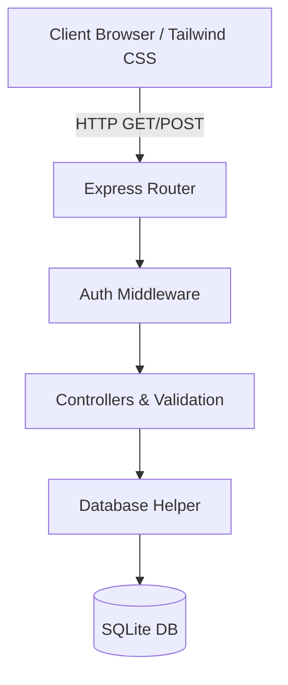

# Enterprise CRM


A robust, enterprise-grade Customer Relationship Management (CRM) built with an unyielding focus on Clean Architecture, ACID-compliant transactions, and a beautiful Tailwind CSS design system.

---

## 🏗️ Architecture



## ✨ Built With
- **Frontend:** Vanilla JS, HTML5, and **Tailwind CSS** (via CDN for rapid prototyping and zero-build overhead). Glassmorphism UI patterns and responsive design natively built in.
- **Backend:** Node.js, Express.js.
- **Database:** `sql.js` (SQLite in-memory/file).
- **Security:** `helmet` for headers, `express-rate-limit`, bcrypt for password hashing, and JWT for stateless authentication.

## 🧠 Why & Trade-Offs
- **Tailwind CSS via CDN:** Chosen for zero-configuration, immediate UI iteration, and stripping away redundant `style.css` complexity. *Trade-off:* Slightly heavier initial HTML load and missing PurgeCSS for production. Ideal for proof-of-concept enterprise dashboards.
- **Synchronous SQLite (`sql.js`):** Ensures absolute predictability for small datasets and guarantees ACID properties strictly through manual rollback/commit mechanisms. *Trade-off:* Blocks the Node.js event loop on large queries. Fits well for single-tenant ERP solutions but requires scaling (e.g., PostgreSQL) for heavy concurrency.
- **Centralized Error Handling:** All controllers are wrapped in custom `asyncHandler` or `syncHandler` interceptors that pipe errors directly into Express's error middleware. *Trade-off:* Minor boilerplate in controller exports, but guarantees a 100% leak-proof HTTP response cycle.

## 🚀 Quick Start

1. **Install Dependencies**
   ```bash
   npm install
   ```

2. **Run the Server**
   ```bash
   npm start
   ```

3. **Access the Application**
   Navigate to `http://localhost:3000` in your web browser.

### Default Accounts
- **Admin:** `admin@crm.com` / `admin123`
- **Manager:** `manager@crm.com` / `admin123`
- **Sales:** `sales@crm.com` / `admin123`
- **Viewer:** `viewer@crm.com` / `admin123`
